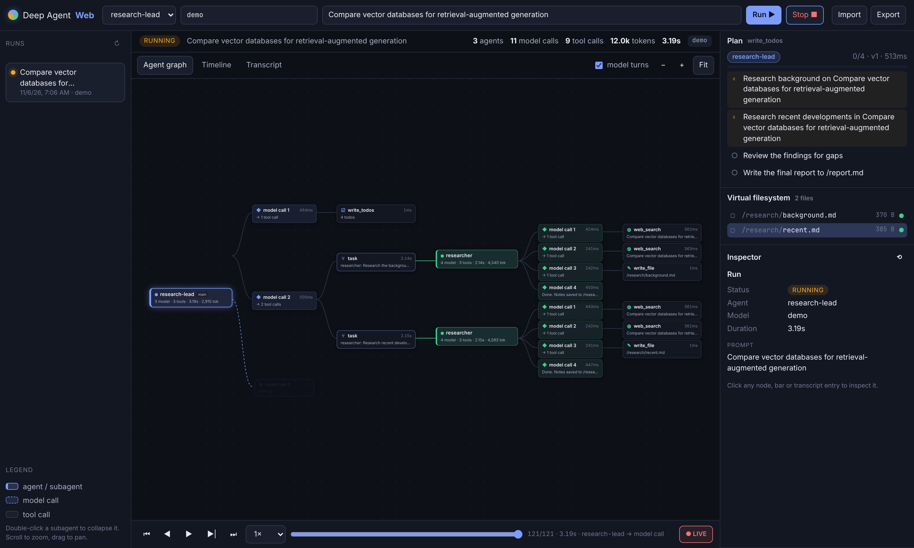
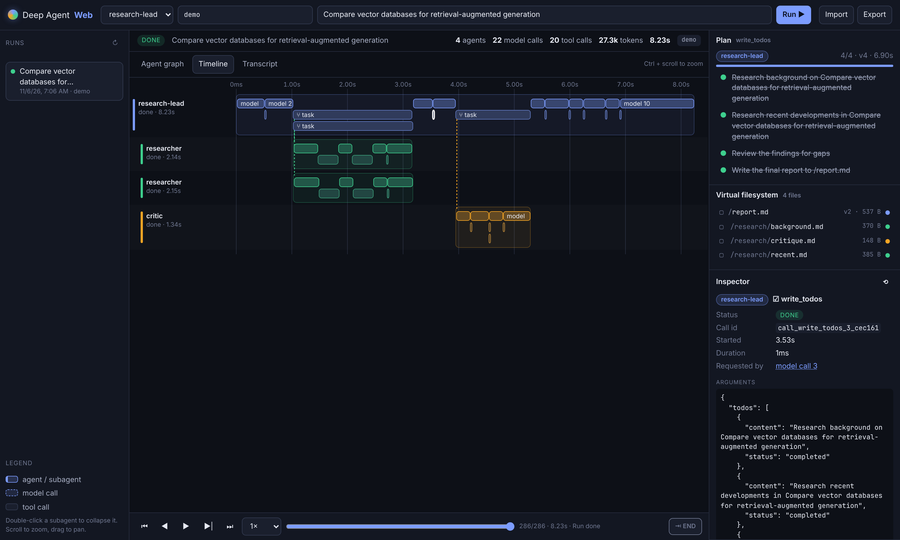

# Deep Agent Web

A browser-based visualiser for [LangChain Deep Agents](https://github.com/langchain-ai/deepagents).
It shows what a deep agent does while it works: how it plans with `write_todos`, how it delegates to subagents with `task`, which tools it calls, and how it reads and writes its virtual filesystem. You can watch a run live, or scrub back through it afterwards.



## Features

- **Agent graph.** A tree with the main agent, then each model turn, the tool calls it made, the subagents those calls spawned, and their own turns and tools. Parallel subagents and parallel tool calls appear side by side. Running nodes glow. You can pan, zoom and fit the view, and double-click a subagent to collapse it.
- **Timeline.** One swimlane per agent. Model calls are on the top row and tool calls are packed below. Dashed connectors run from each `task` call to the subagent it started. Ctrl + scroll zooms.
- **Transcript.** A chronological feed of model output (streamed token by token), reasoning, tool arguments and results. It is indented by agent depth and can be filtered by agent.
- **Plan panel.** The live todo list from `write_todos`, with a progress bar per agent and highlights on status changes.
- **Virtual filesystem.** Every file in the agent's state, coloured by the agent that last wrote it. Click a file for a viewer with version history and a line diff between versions.
- **Inspector.** Click any node, bar or entry to see its arguments, output, latency, token usage, which model call requested it, and the subagent it spawned.
- **Replay.** The whole UI is computed from an event log, so any run can be replayed. You can play it at 0.5–20× speed, step between events (← / →), or scrub with the slider.
- **Saved runs and sharing.** Runs are saved as JSON under `runs/`. You can export them and import them again (or drag and drop the file) on any instance, so you can share a trace without sharing API keys.
- **Offline demo.** A built-in research agent with a `researcher` subagent and a `critic` subagent. It runs on a scripted model, so it needs no API key. It is a real `deepagents` graph; only the model is scripted.



## Quick start

```bash
pip install -e .
```

```bash
deepagent-web            # or: python -m deepagent_web
```

Open http://127.0.0.1:8000, keep the model set to `demo`, and click an example prompt.

To run the demo agent on a real model, install the provider package and set its key:

```bash
pip install -e '.[anthropic]'
```

```bash
export ANTHROPIC_API_KEY=...
```

Then enter a model such as `anthropic:claude-sonnet-5-5` or `openai:gpt-5.5` in the model box. Any `provider:model` string that `init_chat_model` accepts will work. The demo's `web_search` tool returns mock results unless `TAVILY_API_KEY` is set.

## Visualising your own deep agent

Point `--agent` at a compiled graph or at a factory function:

```python
# my_agent.py
from deepagents import create_deep_agent

def make_agent(model: str | None = None):
    return create_deep_agent(model=model or "anthropic:claude-sonnet-5-5", tools=[...], subagents=[...])

# or a ready-made graph:
graph = create_deep_agent(model="openai:gpt-5.5", tools=[...])
```

```bash
deepagent-web --agent my_agent:make_agent --agent my_agent:graph
```

Your agents appear in the agent drop-down. A factory that takes an argument receives the model string typed in the UI. A compiled graph runs as it is. You can also set `DEEPAGENT_WEB_AGENTS=my_agent:graph` (comma-separated) instead of `--agent`.

No changes to your agent are needed. The tracer hooks in through LangChain callbacks and LangGraph's `stream(..., subgraphs=True)`, so it works with any `create_deep_agent` graph, including custom tools, subagents, middleware and backends.

## How it works

```
 browser  ◀──── SSE: JSON events ────  FastAPI  ──── agent.astream(subgraphs=True) ────▶  deep agent
   │                                      │            + callback handler                    (LangGraph)
   └─ fold(events[0..cursor]) → UI        └─ runs/<id>.json
```

`deepagent_web/tracer.py` merges two sources into one flat event log:

| Source | Gives |
| --- | --- |
| LangChain callbacks | `llm_start` / `llm_token` / `llm_end`, `tool_start` / `tool_end`, with exact timings. `lc_subagent_tool_call_id` in the callback metadata says which subagent owns each call. |
| LangGraph state updates | `todos` and `files` changes, attributed to an agent by mapping the subgraph namespace to the `task` call that started it. |

A `task` tool call also emits `agent_start` / `agent_end` for the subagent it runs. The subagent's id is the `task` call's `tool_call_id`, so nested subagents form a tree. Every event carries `seq`, `t` (ms since start) and `type`. The frontend (`static/js/store.js`) folds the events into a view model. Live view and replay are the same code path; replay just stops the fold at an earlier event.

### API

| Method | Path | |
| --- | --- | --- |
| `GET` | `/api/config` | Available agents and suggested models |
| `GET` | `/api/runs` | Run summaries |
| `POST` | `/api/runs` | `{prompt, agent, model}` starts a run |
| `GET` | `/api/runs/{id}` | Full event log (the export format) |
| `GET` | `/api/runs/{id}/stream?since=N` | Server-sent events: replays the log, then follows live. Supports `Last-Event-ID`. |
| `POST` | `/api/runs/{id}/cancel` | Cancel a running run |
| `DELETE` | `/api/runs/{id}` | Delete a finished run |

## Keyboard shortcuts

| Key | Action |
| --- | --- |
| Space | Play / pause the replay |
| ← / → | Previous / next step |
| Home / End | Jump to start / end (and follow live) |
| 1 / 2 / 3 | Graph / Timeline / Transcript |
| F | Fit the graph |
| Esc | Clear the selection |

## Development

```bash
pip install -e '.[dev]'
```

```bash
pytest
```

The frontend is plain ES modules with no build step. Edit the files in `deepagent_web/static/` and reload the page. `DEMO_DELAY` scales the demo model's simulated latency (`0` makes it instant; it is used by the tests).

## Limitations

- Each run is a single turn on a fresh thread. Follow-up messages are not supported yet.
- Human-in-the-loop interrupts (`interrupt_on`) are not supported yet. If one fires, the run stops there, and the `interrupt` is recorded in the event log.
- Runs are kept in memory and saved as JSON files. There is no database.
